## Getting Started with Turtlesim

Start the roscore: 

```
$ roscore
```


To install and start the turtlesim: 

```
$ sudo apt-get install ros-$(rosversion -d)-turtlesim
```

 Run
turtlesim: 

```
$ rosrun turtlesim turtlesim_node
```


You'll see the turtlesim window:

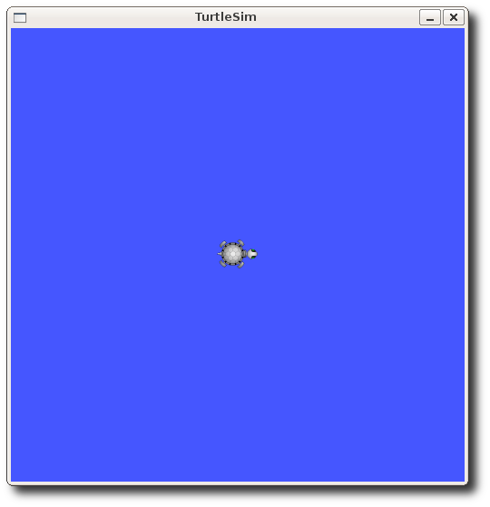

## Nodes == As of //Hydro// turtlesim uses the \[\[https://index.ros.org/p/geometry_msgs\|geometry_msgs\]\]/Twist message instead of its own custom one (//turtlesim/Velocity// in //Groovy// and older). Also the topic has been changed to `cmd_vel` (instead of `command_velocity` before).

### turtlesim_node

`turtlesim_node` provides a simple simulator for teaching ROS
concepts.

#### Subscribed Topics

- `turtleX/cmd_vel`
  ([geometry_msgs/msg/Twist](https://docs.ros.org/en/rolling/p/geometry_msgs/msg/Twist.html)):
  The linear and angular command velocity for turtleX. The turtle will
  execute a velocity command for 1 second then time out. Twist.linear.x
  is the forward velocity, Twist.linear.y is the strafe velocity, and
  Twist.angular.z is the angular velocity.

#### Published Topics

- `turtleX/pose`
  ([turtlesim/msg/Pose](https://docs.ros.org/en/rolling/p/turtlesim/msg/Pose.html)):
  The x, y, theta, linear velocity, and angular velocity of turtleX.

#### Services

- `clear`
  ([std_srvs/srv/Empty](https://docs.ros.org/en/rolling/p/std_srvs/srv/Empty.html)):
  Clears the turtlesim background and sets the color to the value of the
  background parameters.
- `reset`
  ([std_srvs/srv/Empty](https://docs.ros.org/en/rolling/p/std_srvs/srv/Empty.html)):
  Resets the turtlesim to the start configuration and sets the
  background color to the value of the background.
- `kill`
  ([turtlesim/srv/Kill](https://docs.ros.org/en/rolling/p/turtlesim/srv/Kill.html)):
  Kills a turtle by name.
- `spawn`
  ([turtlesim/srv/Spawn](https://docs.ros.org/en/rolling/p/turtlesim/srv/Spawn.html)):
  Spawns a turtle at (x, y, theta) and returns the name of the turtle.
  Also will take name for argument but will fail if a duplicate name.
- `turtleX/set_pen`
  ([turtlesim/srv/SetPen](https://docs.ros.org/en/rolling/p/turtlesim/srv/SetPen.html)):
  Sets the pen's color (r g b), width (width), and turns the pen on and
  off (off).
- `turtleX/teleport_absolute`
  ([turtlesim/srv/TeleportAbsolute](https://docs.ros.org/en/rolling/p/turtlesim/srv/TeleportAbsolute.html)):
  Teleports the turtleX to (x, y, theta).
- `turtleX/teleport_relative`
  ([turtlesim/srv/TeleportRelative](https://docs.ros.org/en/rolling/p/turtlesim/srv/TeleportRelative.html)):
  Teleports the turtleX a linear and angular distance from the turtles
  current position.

#### Parameters

- `~background_b` (`int`, default: `255`): Sets the blue channel of the
  background color.
- `~background_g` (`int`, default: `86`): Sets the green channel of the
  background color.
- `~background_r` (`int`, default: `69`): Sets the red channel of the
  background color.

### mimic

`mimic` provides a simple interface for making one turtlesim mimic
another.

#### Subscribed Topics

- `input`
  ([turtlesim/msg/Pose](https://docs.ros.org/en/rolling/p/turtlesim/msg/Pose.html)):
  The input topic for the `mimic` node. The topic must be remapped to
  the `pose` topic of the desired turtle to mimic.

#### Published Topics

- `output`
  ([geometry_msgs/msg/Twist](https://docs.ros.org/en/rolling/p/geometry_msgs/msg/Twist.html)):
  The output topic for the `mimic` node. The topic must be remapped to
  the `cmd_vel` topic of the mimicking turtle.

## Turtlesim Video Tutorials

### Python Tutorials

Linear Motion [Youtube](https://www.youtube.com/watch?v=4Lifb9Cg_9w)

Go to goal behavior
[Youtube](https://www.youtube.com/watch?v=D7ISrmszozk)

### C++ Tutorials

[Youtube](https://www.youtube.com/watch?v=qtVDso-iBNA)
[Youtube](https://www.youtube.com/watch?v=PGZMlzBlMmw)
[Youtube](https://www.youtube.com/watch?v=Ddqwq2WXFEk)
[Youtube](https://www.youtube.com/watch?v=Qh15Nol5htM)
[Youtube](https://www.youtube.com/watch?v=ehH8oLfsz-w)

## Tutorials

### Tutorials Using Turtlesim

#### ROS Tutorials

- [ROS/Tutorials/UsingRxconsoleRoslaunch](ROS/Tutorials/UsingRxconsoleRoslaunch)
- [ROS/Tutorials/UnderstandingNodes](ROS/Tutorials/UnderstandingNodes)
- [ROS/Tutorials/UnderstandingTopics](ROS/Tutorials/UnderstandingTopics)
- [ROS/Tutorials/UnderstandingServicesParams](ROS/Tutorials/UnderstandingServicesParams)
- [ROS/Tutorials/UsingRqtconsoleRoslaunch](ROS/Tutorials/UsingRqtconsoleRoslaunch)

#### Teleop Tutorials

- [WritingTeleopNode](https://index.ros.org/p/ps3joy)
- [WritingTeleopNode](https://index.ros.org/p/joy)
- [WritingTeleopNode](https://index.ros.org/p/wiimote)
- [WritingTeleopNode](https://index.ros.org/p/spacenav_node)

#### TF Tutorials

Many of the tf tutorials are available for both C++ and Python. The
tutorials are streamlined to complete either the C++ track or the Python
track. If you want to learn both C++ and Python, you should run through
the tutorials once for C++ and once for Python. Note that the general
concept itself is explained directly on
[tf package](https://index.ros.org/p/tf).


```wiki
tf is deprecated in favor of [[tf2]]. [[tf2]] provides a superset of the functionality of tf and is actually now the implementation under the hood. If you're just learning now it's strongly recommended to use the [[tf2/Tutorials]] instead.
```


### Workspace Setup

If you have not yet created a workspace in which to complete the
tutorials, <<SeeSaw("EnvironmentSetup", toshow="click here for some
brief instructions")>>.


```
{{{{#!wiki seesaw EnvironmentSetup

<<Version()>>

{{

To overlay on the `ROS` distro you are using:
{{{
rosinstall ~/tutorials /opt/ros/$ROS_DISTRO>> ~/tutorials.rosinstall
```


To use this workspace **whenever** you open a new terminal setup your
ROS environment by typing: 

```
source ~/tutorials/setup.bash
```


Sourcing this file adds `/tutorials/workspace` to your
ROS_PACKAGE_PATH.

Any packages you create in that directory will be found by
[rospack](https://index.ros.org/p/rospack).

An alternative to source your script file is to add it to your
`.bashrc`, but remember that this will persist in your `.bashrc`
into the future, and you can only have one environment setup. For more
on what this is doing see [this page](rosinstall#Generating_setup.sh)
}}}}}


```
{{#!wiki version groovy_and_newer
Create a [[catkin]] workspace like so:

{{{
$ source /opt/ros/$ROS_DISTRO/setup.bash
$ mkdir -p ~/tutorial_ws/src
$ cd ~/tutorial_ws
$ catkin_init_workspace src
$ catkin_make
```


And now source the setup file from the result-space, so that packages
you add to this workspace's `src` folder will be findable by
[rospack](https://index.ros.org/p/rospack), and the built binaries by
[rosrun](rosrun) and [roslaunch](https://index.ros.org/p/roslaunch):


```
$ source devel/setup.bash
```


}}}}}

}}}}}}}

### Learning tf

- [Introduction to tf](https://index.ros.org/p/tf)

  -- ------------------------------------------------------------------------------------------------------------------------------------------------------------------- -- ------------------------------ --
     <width="50%">**C++**                                                                                                                                               <width="50%"> **Python**   
     <width="50%"> \* [Writing a tf broadcaster (C++)](https://index.ros.org/p/tf): This tutorial teaches you how to broadcast coordinate frames of a robot to tf.                                     
  -- ------------------------------------------------------------------------------------------------------------------------------------------------------------------- -- ------------------------------ --

- [Writing a tf listener (C++)](https://index.ros.org/p/tf): This
  tutorial teaches you how to use tf to get access to frame
  transformations.
- [Adding a frame (C++)](https://index.ros.org/p/tf): This tutorial
  teaches you how to add an extra fixed frame to tf.
- [Learning about tf and time (C++)](https://index.ros.org/p/tf): This
  tutorial teaches you to use the waitForTransform function to wait for
  a transform to be available on the tf tree.
- [Time travel with tf (C++)](https://index.ros.org/p/tf): This tutorial
  teaches you about advanced time travel features of
  tf\|\|<width="50%"> \*
  [Writing a tf broadcaster (Python)](https://index.ros.org/p/tf): This
  tutorial teaches you how to broadcast the state of a robot to tf.
- [Writing a tf listener (Python)](https://index.ros.org/p/tf): This
  tutorial teaches you how to use tf to get access to frame
  transformations.
- [Adding a frame (Python)](https://index.ros.org/p/tf): This tutorial
  teaches you how to add an extra fixed frame to tf.
- [Learning about tf and time (Python)](https://index.ros.org/p/tf):
  This tutorial teaches you to use the `waitForTransform` function to
  wait for a transform to be available on the `tf` tree.
- [Time travel with tf (Python)](https://index.ros.org/p/tf): This
  tutorial teaches you about advanced time travel features of tf\|\|

**Now that you have completed these tutorials please take the time to
complete this short
[questionnaire](http://spreadsheets.google.com/viewform?formkey=dHVTdXEwZU1QQ004TFBnbVh0MU9lLWc6MA..).**

### Debugging tf

1\. [Debugging tf problems](https://index.ros.org/p/tf)

### Using sensor messages with tf

- [Using Stamped datatypes with tf::MessageFilter](https://index.ros.org/p/tf):
  This tutorial describes how to use
  [tf](https://index.ros.org/p/tf)::MessageFIlter to process Stamped
  datatypes.

### Setting up your robot with tf

- [Setting up your robot using tf](https://index.ros.org/p/navigation):
  This tutorial provides a guide to set up your robot to start using tf.
- [Using the robot state publisher on your own robot](https://index.ros.org/p/robot_state_publisher):
  This tutorial explains how you can publish the state of your robot to
  [tf](https://index.ros.org/p/tf), using the robot state publisher.
- [Using urdf with robot_state_publisher](https://index.ros.org/p/urdf):
  This tutorial gives a full example of a robot model with URDF that
  uses robot_state_publisher. First, we create the URDF model with all
  the necessary parts. Then we write a node which publishes the
  JointState and transforms. Finally, we run all the parts together.

### Video Demonstration

Watch the video below to have more explanation on transforms.
[Youtube](https://www.youtube.com/watch?v=QhGxqLDeKvA)

### PR2 Beta Workshop

[Youtube](https://www.youtube.com/watch?v=A0ocyo9Ihwc)
[Youtube](https://www.youtube.com/watch?v=Ra-nXIfPWdg)
[Youtube](https://www.youtube.com/watch?v=Xf25dVrG5ks)
[Youtube](https://www.youtube.com/watch?v=EQTjA3mREZo)
[Youtube](https://www.youtube.com/watch?v=mCyOb1r2nH4)

### Video Tutorials

[Youtube](https://www.youtube.com/watch?v=qtVDso-iBNA)
[Youtube](https://www.youtube.com/watch?v=PGZMlzBlMmw)
[Youtube](https://www.youtube.com/watch?v=Ddqwq2WXFEk)
[Youtube](https://www.youtube.com/watch?v=Qh15Nol5htM)
[Youtube](https://www.youtube.com/watch?v=ehH8oLfsz-w)

#### rosbag Tutorials

- [Recording and playing back data](https://index.ros.org/p/rosbag):
  This tutorial will teach you how to record data from a running ROS
  system into a .bag file, and then to play back the data to produce
  similar behavior in a running system
- [Reading messages from a bag file](https://index.ros.org/p/rosbag):
  Learn two ways to read messages from desired topics in a bag file,
  including using the really handy **ros_readbagfile** script.
- [Producing filtered bag files](https://index.ros.org/p/rosbag): This
  tutorial will cover using **rosbag filter** to filter bag files into
  new bag files using topic and data information

### Practicing Python with Turtlesim

1.[Moving in a Straight Line](#moving-in-a-straight-line)
This tutorial teaches you how to move your turtle in order to learn
python.

2.[Rotating Left/Right](#rotating-leftright)
This tutorial teaches you how to rotate your turtle.

3.[Moving to goal](#go-to-goal)
Move the turtle to a specified location.

### Create a new tutorial

## Moving in a Straight Line

!

- **Note:** This tutorial assumes that you have completed the previous
  tutorials: writing a simple publisher and subscriber
  [(python)](ROS/Tutorials/WritingPublisherSubscriber(python)).
- **Description:** This tutorial is based on
  [Turtlesim Video Tutorials](#tutorials)
- **Tutorial Level:** INTERMEDIATE
- **Next Tutorial:**
  [Rotating Left/Right](#rotating-leftright)

In this tutorial series, we will create python scripts to move our
turtle, in order to practice the ROS basics.

You can find the complete package at:
<https://github.com/clebercoutof/turtlesim_cleaner>

### Preparing for work

First of all, we have to create a new package.


```
$ cd ~/catkin_ws/src
$ catkin_create_pkg turtlesim_cleaner geometry_msgs rospy
```

 Now, build your workspace


```
#At your catkin workspace
$ cd ~/catkin_ws
$ catkin_make
```

 And now, create a a src folder for your scripts


```
$ cd ~/catkin_ws/src/turtlesim_cleaner
$ mkdir src
$ cd ~/catkin_ws
$ catkin_make
```


### Understanding the code

Our code will receive as inputs the desired speed, distance and a
variable which defines if the movement is forwards or backwards. Since
we can just publish a velocity to the topic **`' /turtle1/cmd_vel`**',
our logic will have to calculate the distance specified.

### The code

Create your move.py (or any name you want) file and save it in your
**`'~/catkin_ws/src/turtlesim_cleaner/src`**', our code will look like
this:


```python
#!/usr/bin/env python
import rospy
from geometry_msgs.msg import Twist

def move():
    # Starts a new node
    rospy.init_node('robot_cleaner', anonymous=True)
    velocity_publisher = rospy.Publisher('/turtle1/cmd_vel', Twist, queue_size=10)
    vel_msg = Twist()

    #Receiveing the user's input
    print("Let's move your robot")
    speed = input("Input your speed:")
    distance = input("Type your distance:")
    isForward = input("Foward?: ")#True or False

    #Checking if the movement is forward or backwards
    if(isForward):
        vel_msg.linear.x = abs(speed)
    else:
        vel_msg.linear.x = -abs(speed)
    #Since we are moving just in x-axis
    vel_msg.linear.y = 0
    vel_msg.linear.z = 0
    vel_msg.angular.x = 0
    vel_msg.angular.y = 0
    vel_msg.angular.z = 0

    while not rospy.is_shutdown():

        #Setting the current time for distance calculus
        t0 = rospy.Time.now().to_sec()
        current_distance = 0

        #Loop to move the turtle in an specified distance
        while(current_distance < distance):
            #Publish the velocity
            velocity_publisher.publish(vel_msg)
            #Takes actual time to velocity calculus
            t1=rospy.Time.now().to_sec()
            #Calculates distancePoseStamped
            current_distance= speed*(t1-t0)
        #After the loop, stops the robot
        vel_msg.linear.x = 0
        #Force the robot to stop
        velocity_publisher.publish(vel_msg)

if __name__ == '__main__':
    try:
        #Testing our function
        move()
    except rospy.ROSInterruptException: pass
```

 Don't forget to make your node executable:


```
$ chmod u+x ~/catkin_ws/src/turtlesim_cleaner/src/move.py
```

 First we need to import the packages used on
our script.The rospy library is the ros python library, it contains the
basic functions, like creating a node, getting time and creating a
publisher.The geometry_msgs contains the variable type **Twist** that
will be used:

Now we declare our function, initiate our node, our publisher and create
the **Twist** variable.

The **Twist** is necessary because our topic **'/turtle1/cmd_vel'**
uses the Twist message, you can check with the following command:


```
$ rostopic info /turtle1/cmd_vel
```

 You should see the following screen:

. 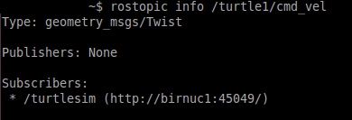

The Twist message is composed by 3 linear components and 3 angular
components,you can see the message description with the following
command:


```
$ rosmsg show geometry_msgs/Twist
```

 You should see the following screen:

. 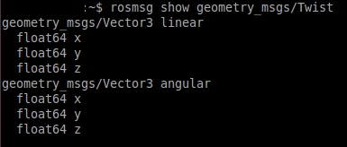

Since we are moving the turtle in a straight line, we just need the x
component, and, depending on the user's input we decide if the movement
is forwards or backwards.

The following statement guarentee that if we press **crtl + c** our code
will stops

Now , with the **rospy.Time.now().to_sec()**. we get the starting time
**t0**, and the time **t1** to calculate the distance and while the
actual distance is less than the user's input, it will keep publishing:

After we get to the specified distance , we order our robot to stop:

And then, we have our main loop which calls our function:

Now , you can test and move your robot!

### Testing the code

In a **new terminal**, run:


```
$ roscore
```

 In a **new terminal**, run:


```
$ rosrun turtlesim turtlesim_node
```

 The turtlesim window will open:

. 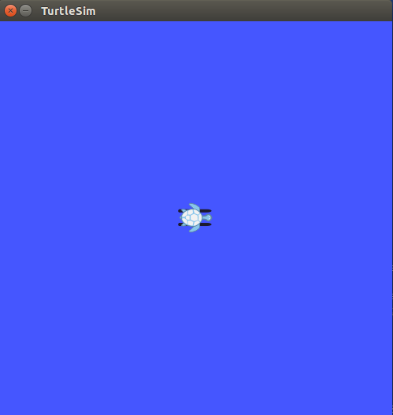

Now, in a **new terminal**, run our code:


```
$ rosrun turtlesim_cleaner move.py
```

 Just type your inputs and the turtle will move!
Here we have an example:


```
Let's move your robot
Input your speed:1
Type your distance:3
Foward?: 0
```

 The turtle will move like this:

. 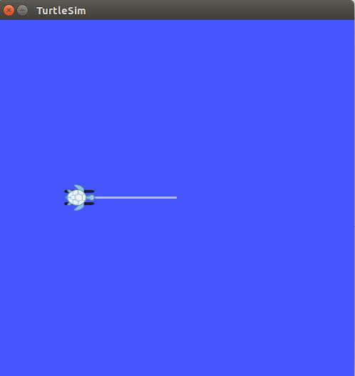

Now you can go to the next tutorial! Learn how to
[rotate](#rotating-leftright)
your turtle.

## Rotating Left/Right

!

- **Note:** This tutorial assumes that you have completed the previous
  tutorials:
  [Moving in a Straight Line](#moving-in-a-straight-line).
- **Description:** This tutorial is based on
  [Turtlesim Video Tutorials](#tutorials)
- **Tutorial Level:** INTERMEDIATE
- **Next Tutorial:**
  [Moving to goal](#go-to-goal)

You can find the complete package at:
<https://github.com/clebercoutof/turtlesim_cleaner>

Now, we are going to rotate the turtle.

### Preparing for work

Let's create our file **rotate.py**( or any name you want) and paste it
in the source directory of our package, if you followed the past
tutorial it will be: **`'~/catkin_ws/src/turtlesim_cleaner/src`**'.
Then , don't forget to make the node executable:


```
$ chmod u+x ~/catkin_ws/src/turtlesim_cleaner/src/rotate.py
```


### Understanding the code

Similar as the past tutorial code, we will receive the speed, distance
and a variable wich defines if the movement is clockwise or
counter-clockwise. Since we can just publish a velocity to the topic
**`' /turtle1/cmd_vel`**', our logic will have to calculate the
distance specified, but in this case it will be an **angular velocity**.

### The Code


```python
#!/usr/bin/env python
import rospy
from geometry_msgs.msg import Twist
PI = 3.1415926535897

def rotate():
    #Starts a new node
    rospy.init_node('robot_cleaner', anonymous=True)
    velocity_publisher = rospy.Publisher('/turtle1/cmd_vel', Twist, queue_size=10)
    vel_msg = Twist()

    # Receiveing the user's input
    print("Let's rotate your robot")
    speed = input("Input your speed (degrees/sec):")
    angle = input("Type your distance (degrees):")
    clockwise = input("Clockwise?: ") #True or false

    #Converting from angles to radians
    angular_speed = speed*2*PI/360
    relative_angle = angle*2*PI/360

    #We wont use linear components
    vel_msg.linear.x=0
    vel_msg.linear.y=0
    vel_msg.linear.z=0
    vel_msg.angular.x = 0
    vel_msg.angular.y = 0

    # Checking if our movement is CW or CCW
    if clockwise:
        vel_msg.angular.z = -abs(angular_speed)
    else:
        vel_msg.angular.z = abs(angular_speed)
    # Setting the current time for distance calculus
    t0 = rospy.Time.now().to_sec()
    current_angle = 0

    while(current_angle < relative_angle):
        velocity_publisher.publish(vel_msg)
        t1 = rospy.Time.now().to_sec()
        current_angle = angular_speed*(t1-t0)


    #Forcing our robot to stop
    vel_msg.angular.z = 0
    velocity_publisher.publish(vel_msg)
    rospy.spin()

if __name__ == '__main__':
    try:
        # Testing our function
        rotate()
    except rospy.ROSInterruptException:
        pass
```

 First we need to import the packages used on
our script.The rospy library is the ros python library, it contains the
basic functions, like creating a node, getting time and creating a
publisher.The geometry_msgs contains the variable type Twist that will
be used, and we define a constant PI that will be required:

Now we declare our function, initiate our node, our publisher and create
the **Twist** variable.

The **Twist** is necessary because our topic **'/turtle1/cmd_vel'**
uses the Twist message, you can check with the following command:


```
$ rostopic info /turtle1/cmd_vel
```


You should see the following screen:


The Twist message is composed by 3 linear components and 3 angular
components,you can see the message description with the following
command: 

```
$ rosmsg show geometry_msgs/Twist
```


You should see the following screen:


The unit used by ROS is radians, so we have to convert the input from
degrees to radians. Note that this **isn't necessary**, but for
didactic purposes it's better to use the input on degrees, in the
following statements the code does the conversion:

Since we are just rotating the turtle, we don't need the linear
components, and , depending on the user's input we decide if the
movement will be clockwise or counter-clockwise:

Now , with the **rospy.Time.now().to_sec()**. we get the starting time
**t0**, and the time **t1** to calculate the angular distance:

And while the actual distance is less than the user's input, it will
keep publishing:

After we get to the specified angle , we order our robot to stop:

The following statement guarantees that if we press **ctrl+c** our code
will stop:

And then, we have our main loop which calls our function: Now, you can
test and move your robot.

### Testing the code

In a **new terminal**, run: 

```
$ roscore
```


In a **new terminal**, run: 

```
$ rosrun turtlesim turtlesim_node
```


The turtlesim window will open:

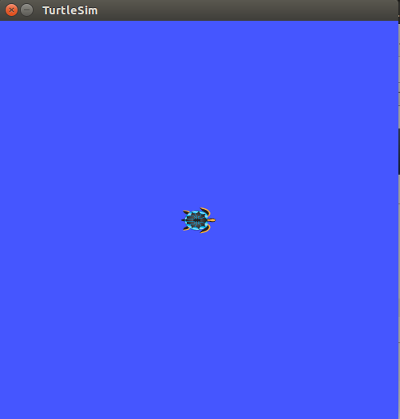

Now, in a **new terminal**, run our code: 

```
$ rosrun turtlesim_cleaner rotate.py
```


Just type your inputs and the turtle will rotate! Here we have an
example: 

```
Let's rotate your robot
Input your speed (degrees/sec):30
Type your distance (degrees):75
Clowkise?: 0
```


The turtle will rotate like this:

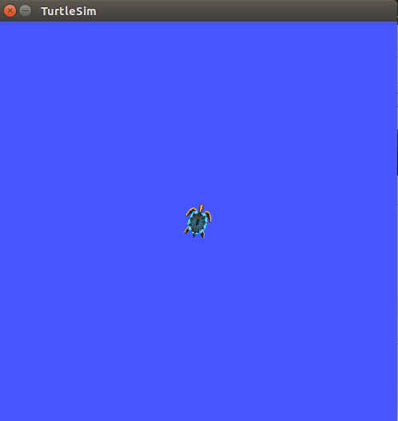

Now you can go to the next tutorial! Learn how to move your to a
specified [goal](#go-to-goal).

## Go to Goal

!

- **Description:** This tutorial is based on
  [Turtlesim Video Tutorials](#tutorials)
- **Tutorial Level:** INTERMEDIATE

You can find the complete package at:
<https://github.com/clebercoutof/turtlesim_cleaner>

Now we are going to move the turtle to a specified location.

### Preparing for work

Let's create our file `gotogoal.py` (or any name you want) and paste
it in the source directory of our package: if you followed the past
tutorial, it will be: `/catkin_ws/src/turtlesim_cleaner/src`. Then,
don't forget to make the node executable: 

```
$ chmod u+x ~/catkin_ws/src/turtlesim_cleaner/src/gotogoal.py
```


### Understanding the code

#### The TurtleBot Class

The class `TurtleBot` will contain all the aspects of our robot, such
as pose, the publisher and subscriber, the subscriber callback function
and the "move to goal" function.

#### The Subscriber

Our subscriber will subscribe to the topic `'/turtle1/pose'`, which
is the topic to which the actual `turtlesim` position is published.
The function `update_pose` is called when a message is received and
saves the actual position in a class attribute called `pose`.

#### The euclidean_distance method

This method will use the previously saved turtle position (i.e.
`self.pose`) and the argument (i.e. `data`) to calculate the
point-to-point (Euclidean) distance between the turtle and the goal.

#### The Proportional Controller

In order for our robot to move, we will use a
[Proportional control](https://en.wikipedia.org/wiki/Proportional_control)
for linear speed and angular velocity. The linear speed will consist of
a constant multiplied by the distance between the turtle and the goal
and the angular speed will depend on the arctangent of the distance in
the y-axis by the distance in the x-axis multiplied by a constant. You
can check the
[Go to Goal Turtlesim Video Tutorials](#tutorials)
for better explanation·

#### Tolerance

We have to create a tolerance zone around our goal point, since a really
high precision to get exactly to the goal would be needed. In this code,
if we use a really small precision the turtle would go crazy (you can
have a try!). *In other words, the code and the simulator are
simplified, so it won't work with full precision.*

### The Code


```python
#!/usr/bin/env python
#!/usr/bin/env python
import rospy
from geometry_msgs.msg import Twist
from turtlesim.msg import Pose
from math import pow, atan2, sqrt


class TurtleBot:

    def __init__(self):
        # Creates a node with name 'turtlebot_controller' and make sure it is a
        # unique node (using anonymous=True).
        rospy.init_node('turtlebot_controller', anonymous=True)

        # Publisher which will publish to the topic '/turtle1/cmd_vel'.
        self.velocity_publisher = rospy.Publisher('/turtle1/cmd_vel',
                                                  Twist, queue_size=10)

        # A subscriber to the topic '/turtle1/pose'. self.update_pose is called
        # when a message of type Pose is received.
        self.pose_subscriber = rospy.Subscriber('/turtle1/pose',
                                                Pose, self.update_pose)

        self.pose = Pose()
        self.rate = rospy.Rate(10)

    def update_pose(self, data):
        """Callback function which is called when a new message of type Pose is
        received by the subscriber."""
        self.pose = data
        self.pose.x = round(self.pose.x, 4)
        self.pose.y = round(self.pose.y, 4)

    def euclidean_distance(self, goal_pose):
        """Euclidean distance between current pose and the goal."""
        return sqrt(pow((goal_pose.x - self.pose.x), 2) +
                    pow((goal_pose.y - self.pose.y), 2))

    def linear_vel(self, goal_pose, constant=1.5):
        """See video: https://www.youtube.com/watch?v=Qh15Nol5htM."""
        return constant * self.euclidean_distance(goal_pose)

    def steering_angle(self, goal_pose):
        """See video: https://www.youtube.com/watch?v=Qh15Nol5htM."""
        return atan2(goal_pose.y - self.pose.y, goal_pose.x - self.pose.x)

    def angular_vel(self, goal_pose, constant=6):
        """See video: https://www.youtube.com/watch?v=Qh15Nol5htM."""
        return constant * (self.steering_angle(goal_pose) - self.pose.theta)

    def move2goal(self):
        """Moves the turtle to the goal."""
        goal_pose = Pose()

        # Get the input from the user.
        goal_pose.x = float(input("Set your x goal: "))
        goal_pose.y = float(input("Set your y goal: "))

        # Please, insert a number slightly greater than 0 (e.g. 0.01).
        distance_tolerance = input("Set your tolerance: ")

        vel_msg = Twist()

        while self.euclidean_distance(goal_pose) >= distance_tolerance:

            # Porportional controller.
            # https://en.wikipedia.org/wiki/Proportional_control

            # Linear velocity in the x-axis.
            vel_msg.linear.x = self.linear_vel(goal_pose)
            vel_msg.linear.y = 0
            vel_msg.linear.z = 0

            # Angular velocity in the z-axis.
            vel_msg.angular.x = 0
            vel_msg.angular.y = 0
            vel_msg.angular.z = self.angular_vel(goal_pose)

            # Publishing our vel_msg
            self.velocity_publisher.publish(vel_msg)

            # Publish at the desired rate.
            self.rate.sleep()

        # Stopping our robot after the movement is over.
        vel_msg.linear.x = 0
        vel_msg.angular.z = 0
        self.velocity_publisher.publish(vel_msg)

        # If we press control + C, the node will stop.
        rospy.spin()

if __name__ == '__main__':
    try:
        x = TurtleBot()
        x.move2goal()
    except rospy.ROSInterruptException:
        pass
```


First, we import the libraries that will be needed. The `rospy` and
`geometry_msgs` were discussed in the previous tutorials. The `math`
library contains the function that will be used, such as `atan`,
`sqrt` and `round`. The `turtlesim.msg` contains the `Pose`
message type, which is the one published to the topic
`'/turtle1/pose'`. You can check with the following command:


```
$ rostopic info /turtle1/pose
```


You should see the following screen:

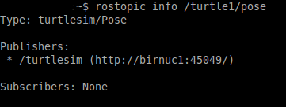

The pose message is composed by the x and y coordinates, the theta
angle, linear velocity and angular velocity. You can see this info with
the following command:


```
$ rosmsg show turtlesim/Pose
```


You should see the following screen:

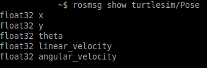

Then we create our class. In the `__init__` method, we initiate
the node, publisher, subscriber and the pose object. It's necessary to
set a "publishing rate" in this case too:

The `update_pose` method is a callback function which will be used by
the subscriber: it will get the turtle current pose and save it in the
`self.pose` attribute:

The `euclidean_distance` method will be used to calculate the distance
between the previously saved turtle position and the goal position:

The `move2goal` method will be the one which moves the turtle. First,
we create the `goal_pose` object, which will receive the user's
input, and it has the same type as the `self.pose` object. Then, we
declare the `vel_msg` object, which will be published in
`'/turtle1/cmd_vel'`:

In the `while` loop, we will keep publishing until the distance of the
turtle to the goal is less than the `distance_tolerance`:

At the end of the loop, we order the turtle to stop:

The following statement causes the node to publish at the desired rate:

The following statement guarantees that if we press *CTRL + C* our code
will stop:

Finally, we call our function `move2goal` after having created an
object `x` of type `TurtleBot`:

### Testing the code

In a **new terminal**, run: 

```
$ roscore
```


In a **new terminal**, run:


```
$ rosrun turtlesim turtlesim_node
```


The `turtlesim` window will open:

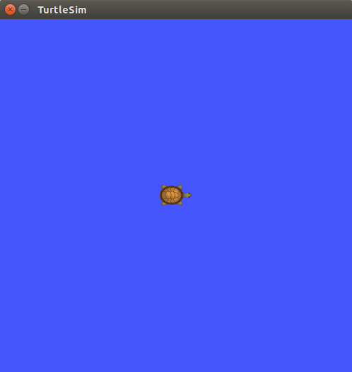

Now, in a **new terminal**, run our code: 

```
$ rosrun turtlesim_cleaner gotogoal.py
```


Just type your inputs and the turtle will move! Here we have an example:


```
rosrun turtlesim_cleaner gotogoal.py 
Set your x goal: 1
Set your y goal: 1
Set your tolerance: 0.5
```


The turtle will move like this:

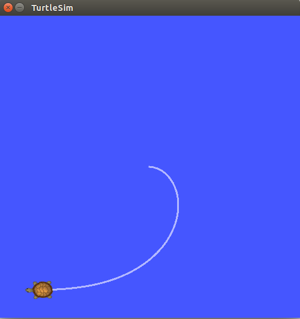

Congratulations! You have finished the tutorials!
